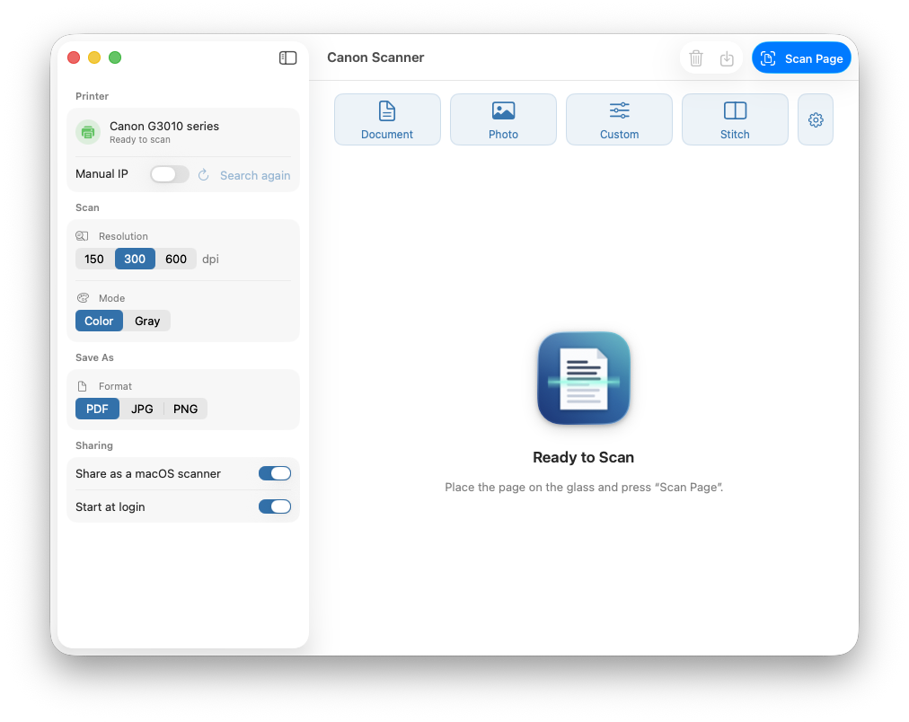

# CanonScan for Mac

App de macOS para escanear por WiFi con impresoras Canon PIXMA G3010 / G3110, que en macOS 26 ya no funcionan con el driver oficial.

macOS app to scan over Wi-Fi with Canon PIXMA G3010 / G3110 printers, which no longer work with the official driver on macOS 26.

[Español](#español) · [English](#english)

<p align="center"></p>

---

## Español

### Por qué

La G3010 / G3110 no ofrece escaneo AirPrint (eSCL) ni responde BJNP por la red. Escanea con **CHMP**, un protocolo de Canon sobre HTTP (puerto 80). CanonScan habla CHMP directamente: no necesita el driver de Canon, SANE, Python ni Homebrew.

### Funciones

- **Modos de un clic:** Documento, Foto, Personalizado y Unir (dos mitades de un original grande). Cada modo tiene sus propios ajustes (⌘,): resolución, color, formato, carpeta, nombre automático, subcarpeta por fecha y mostrar en Finder.
- **Correcciones:** enderezar, recortar al documento o a la foto y PDF con texto buscable (OCR), con Vision de macOS.
- Busca la impresora sola por Bonjour, o usa una IP manual.
- 150, 300 o 600 dpi, en color o gris.
- Varias páginas en un solo PDF, con opción de reordenar y borrar.
- Guarda en PDF, JPG o PNG.
- **Escáner nativo de macOS (AirScan):** un puente en la barra de menú hace que la impresora aparezca en Captura de Imagen, Vista Previa y otras apps, también para otros equipos de tu red. Puede iniciarse con la sesión.
- Interfaz en español e inglés (según el idioma de macOS).
- App universal (Apple Silicon e Intel), macOS 13 o superior.

### Limitaciones

- Solo vidrio (sin alimentador). La app escanea A4 completo; por AirScan se recorta la zona elegida.
- Por AirScan solo entrega JPEG; usa la app para PDF de varias páginas.
- Probado con una G3110 (se anuncia como «G3010 series»). Otros modelos con CHMP podrían funcionar, sin garantía.
- No es un driver oficial de Canon; el protocolo se obtuvo por ingeniería inversa.

### Instalar

1. Descarga `CanonScan-0.1.dmg` desde [Releases](https://github.com/gonzalovalenzuela/CanonScan-for-Mac/releases/latest), ábrelo y arrastra **CanonScan** a **Aplicaciones**.
2. La app no está firmada por Apple. La primera vez macOS la bloquea: ve a **Ajustes del Sistema → Privacidad y seguridad** y presiona **Abrir de todas formas**.
3. Acepta el permiso de **Red local** (CanonScan y CanonScan Bridge lo piden una vez).
4. Al abrirla por primera vez pregunta si el puente AirScan debe iniciarse con la sesión. Se puede cambiar en la barra lateral, sección *Compartir*.

Para desinstalar, borra `CanonScan.app` (el puente va dentro).

### Compilar

Requiere Xcode (Swift 5.9 o superior).

```sh
./build.sh      # solo la app, en build/latest/
./package.sh    # app + .dmg en dist/ (se publica en Releases)
```

### Créditos

El cliente CHMP está portado a Swift desde [dfrancio-DF/canon-g3010-sane](https://github.com/dfrancio-DF/canon-g3010-sane), derivado de [wailun42/canon-g3010-chmp-scanner](https://github.com/wailun42/canon-g3010-chmp-scanner). Ver [THIRD_PARTY_NOTICES.md](THIRD_PARTY_NOTICES.md).

---

## English

### Why

The G3010 / G3110 offers no AirPrint scanning (eSCL) and doesn't answer BJNP on the network. It scans with **CHMP**, a Canon protocol over HTTP (port 80). CanonScan speaks CHMP directly: no Canon driver, SANE, Python or Homebrew needed.

### Features

- **One-click modes:** Document, Photo, Custom and Stitch (two halves of a large original). Each mode has its own settings (⌘,): resolution, color, format, folder, automatic name, date subfolder and show in Finder.
- **Corrections:** straighten, crop to document or photo, and searchable text PDF (OCR), using macOS Vision.
- Finds the printer automatically via Bonjour, or uses a manual IP.
- 150, 300 or 600 dpi, color or gray.
- Multiple pages in one PDF, with reordering and deleting.
- Saves as PDF, JPG or PNG.
- **Native macOS scanner (AirScan):** a menu bar bridge makes the printer show up in Image Capture, Preview and other apps, also for other devices on your network. It can start at login.
- Spanish and English interface (follows the macOS language).
- Universal app (Apple Silicon and Intel), macOS 13 or later.

### Limitations

- Flatbed only (no feeder). The app scans full A4; over AirScan the chosen region is cropped.
- Over AirScan it only delivers JPEG; use the app for multi-page PDF.
- Tested with a G3110 (it advertises itself as "G3010 series"). Other CHMP models may work, no guarantee.
- Not an official Canon driver; the protocol was reverse-engineered.

### Install

1. Download `CanonScan-0.1.dmg` from [Releases](https://github.com/gonzalovalenzuela/CanonScan-for-Mac/releases/latest), open it and drag **CanonScan** to **Applications**.
2. The app isn't signed by Apple. The first time, macOS blocks it: go to **System Settings → Privacy & Security** and click **Open Anyway**.
3. Allow **Local Network** access (CanonScan and CanonScan Bridge ask once).
4. On first launch it asks whether the AirScan bridge should start at login. You can change it in the sidebar, *Sharing* section.

To uninstall, delete `CanonScan.app` (the bridge is inside it).

### Build

Requires Xcode (Swift 5.9 or later).

```sh
./build.sh      # app only, in build/latest/
./package.sh    # app + .dmg in dist/ (published in Releases)
```

### Credits

The CHMP client is ported to Swift from [dfrancio-DF/canon-g3010-sane](https://github.com/dfrancio-DF/canon-g3010-sane), derived from [wailun42/canon-g3010-chmp-scanner](https://github.com/wailun42/canon-g3010-chmp-scanner). See [THIRD_PARTY_NOTICES.md](THIRD_PARTY_NOTICES.md).

---

Canon y PIXMA son marcas de Canon Inc. Este proyecto no está afiliado a Canon.
Canon and PIXMA are trademarks of Canon Inc. This project is not affiliated with Canon.
