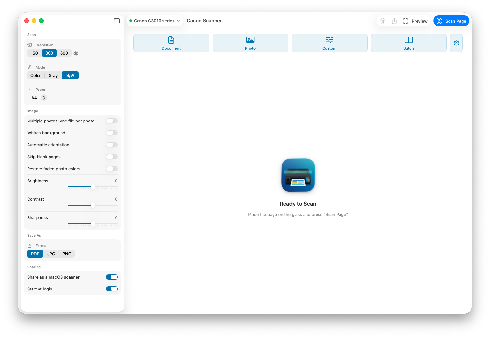

# CanonScan for Mac

App de macOS para escanear por WiFi o USB con impresoras Canon PIXMA G3010 / G3110, que en macOS 26 ya no funcionan con el driver oficial.

macOS app to scan over Wi-Fi or USB with Canon PIXMA G3010 / G3110 printers, which no longer work with the official driver on macOS 26.

[Español](#español) · [English](#english)

<p align="center"></p>

---

## Español

### Por qué

La G3010 / G3110 no ofrece escaneo AirPrint (eSCL) ni responde BJNP por la red. Escanea con **CHMP**, un protocolo de Canon sobre HTTP (puerto 80); por USB usa los mismos mensajes por los canales bulk de la interfaz del escáner. CanonScan habla ese protocolo directamente: no necesita el driver de Canon, SANE, Python ni Homebrew.

### Funciones

- **Conexión:** WiFi (la busca sola por Bonjour, o con IP manual) o **USB** (más rápido). Se elige en la lista de impresoras.
- **Modos de un clic:** Documento, Foto, Personalizado y Unir (dos mitades de un original grande), cada uno con sus propios ajustes.
- **Correcciones:** enderezar, recortar al documento o a la foto, y PDF con texto buscable (OCR), con Vision de macOS.
- 150, 300 o 600 dpi, en color, gris o blanco y negro. Papel A4, Carta, A5, tarjeta, foto 10×15 y 13×18, o el vidrio completo.
- **Vista previa** para elegir la zona a escanear.
- **Mejoras de imagen:** blanquear fondo, orientación automática, saltar páginas en blanco, restaurar colores de fotos antiguas, brillo, contraste y nitidez. Varias fotos en el vidrio se guardan en archivos separados.
- **Páginas:** editor para girar y recortar, y reordenar arrastrando.
- Guarda en PDF (también de varias páginas, con calidad ajustable y contraseña opcional), JPG o PNG. Nombres con `{fecha}` y `{hora}`.
- **Después de guardar:** mostrar en Finder, abrir con una app o adjuntar a un correo nuevo.
- **Escáner nativo de macOS (AirScan):** un puente en la barra de menú hace que la impresora aparezca en Captura de Imagen, Vista Previa y otras apps, también para otros equipos de tu red.
- Interfaz en español e inglés (según el idioma de macOS). App universal (Apple Silicon e Intel), macOS 13 o superior.

### Instalar

1. Descarga el `.dmg` de la [última versión](https://github.com/gonzalovalenzuela/CanonScan-for-Mac/releases/latest), ábrelo y arrastra **CanonScan** a **Aplicaciones**.
2. La app no está firmada por Apple. La primera vez macOS la bloquea: ve a **Ajustes del Sistema → Privacidad y seguridad** y presiona **Abrir de todas formas**.
3. Acepta el permiso de **Red local** (CanonScan y CanonScan Bridge lo piden una vez).
4. Al abrirla por primera vez pregunta si el puente AirScan debe iniciarse con la sesión.

Para desinstalar, borra `CanonScan.app` (el puente va dentro).

### Uso

- **Escanear con un modo:** pon el original en el vidrio y presiona **Documento**, **Foto**, **Personalizado** o **Unir**. En PDF pregunta si quieres escanear otra página. Las páginas quedan en la ventana y el archivo se guarda según el modo.
- **Ajustes de los modos:** engranaje o **⌘,**. Por modo: color, papel, resolución, recortar, enderezar, mejoras de imagen, formato, OCR, calidad y contraseña del PDF, revisar antes de guardar, nombre de archivo, carpeta, subcarpeta por fecha y qué hacer después de guardar.
- **Vista previa:** presiona **Vista previa**, arrastra sobre la imagen para elegir la zona y presiona **Usar zona**. La zona se aplica a todos los modos hasta que la quites.
- **Editar páginas:** doble clic en una página para girarla o recortarla; arrástrala para cambiar el orden.
- **Unir:** escanea la mitad izquierda; después gira el original 180° y escanea la otra mitad en la misma esquina.
- **Escaneo manual:** elige resolución, color y formato en la barra lateral, presiona **Escanear página** (o **Agregar página**) y luego **Guardar…**.
- **Desde otras apps:** con *Compartir como escáner de macOS* activado, abre **Captura de Imagen** o **Vista Previa → Archivo → Importar desde escáner** y elige la impresora. El ícono de la barra de menú muestra el estado del puente.

### Limitaciones

- Solo vidrio (sin alimentador).
- Por AirScan entrega solo JPEG; para PDF de varias páginas usa la app.
- Unir junta las dos mitades sin buscar la zona en común.
- Probado con una G3110 (se anuncia como «G3010 series»). Otros modelos con CHMP podrían funcionar, sin garantía.
- No es un driver oficial de Canon; el protocolo se obtuvo por ingeniería inversa.

### Compilar

Requiere Xcode (Swift 5.9 o superior).

```sh
./build.sh      # app y puente, en build/latest/
./package.sh    # app + .dmg en dist/ (se publica en Releases)
```

### Créditos

El cliente CHMP está portado a Swift desde [dfrancio-DF/canon-g3010-sane](https://github.com/dfrancio-DF/canon-g3010-sane), derivado de [wailun42/canon-g3010-chmp-scanner](https://github.com/wailun42/canon-g3010-chmp-scanner). Ver [THIRD_PARTY_NOTICES.md](THIRD_PARTY_NOTICES.md).

---

## English

### Why

The G3010 / G3110 offers no AirPrint scanning (eSCL) and doesn't answer BJNP on the network. It scans with **CHMP**, a Canon protocol over HTTP (port 80); over USB it uses the same messages through the scanner interface's bulk pipes. CanonScan speaks that protocol directly: no Canon driver, SANE, Python or Homebrew needed.

### Features

- **Connection:** Wi-Fi (found automatically via Bonjour, or by manual IP) or **USB** (faster). Pick it in the printer list.
- **One-click modes:** Document, Photo, Custom and Stitch (two halves of a large original), each with its own settings.
- **Corrections:** straighten, crop to document or photo, and searchable text PDF (OCR), using macOS Vision.
- 150, 300 or 600 dpi, in color, gray or black and white. A4, Letter, A5, card, 4×6 and 5×7 photo paper, or the full glass.
- **Preview** to choose the area to scan.
- **Image enhancements:** whiten background, auto orientation, skip blank pages, restore old photo colors, brightness, contrast and sharpness. Several photos on the glass are saved as separate files.
- **Pages:** editor to rotate and crop, and drag to reorder.
- Saves as PDF (including multi-page, with adjustable quality and optional password), JPG or PNG. File names with `{date}` and `{time}`.
- **After saving:** show in Finder, open with an app or attach to a new email.
- **Native macOS scanner (AirScan):** a menu bar bridge makes the printer show up in Image Capture, Preview and other apps, also for other devices on your network.
- Spanish and English interface (follows the macOS language). Universal app (Apple Silicon and Intel), macOS 13 or later.

### Install

1. Download the `.dmg` from the [latest release](https://github.com/gonzalovalenzuela/CanonScan-for-Mac/releases/latest), open it and drag **CanonScan** to **Applications**.
2. The app isn't signed by Apple. The first time, macOS blocks it: go to **System Settings → Privacy & Security** and click **Open Anyway**.
3. Allow **Local Network** access (CanonScan and CanonScan Bridge ask once).
4. On first launch it asks whether the AirScan bridge should start at login.

To uninstall, delete `CanonScan.app` (the bridge is inside it).

### Usage

- **Scan with a mode:** place the original on the glass and press **Document**, **Photo**, **Custom** or **Stitch**. For PDF it asks whether to scan another page. Pages stay in the window and the file is saved according to the mode.
- **Mode settings:** gear button or **⌘,**. Per mode: color, paper, resolution, crop, straighten, image enhancements, format, OCR, PDF quality and password, review before saving, file name, folder, date subfolder and what to do after saving.
- **Preview:** press **Preview**, drag over the image to choose the area and press **Use Region**. The region applies to every mode until you remove it.
- **Edit pages:** double-click a page to rotate or crop it; drag it to change the order.
- **Stitch:** scan the left half; then turn the original 180° and scan the other half in the same corner.
- **Manual scan:** choose resolution, color and format in the sidebar, press **Scan Page** (or **Add Page**) and then **Save…**.
- **From other apps:** with *Share as a macOS scanner* on, open **Image Capture** or **Preview → File → Import from Scanner** and pick the printer. The menu bar icon shows the bridge status.

### Limitations

- Flatbed only (no feeder).
- Over AirScan it only delivers JPEG; use the app for multi-page PDF.
- Stitch joins both halves without looking for the overlapping area.
- Tested with a G3110 (it advertises itself as "G3010 series"). Other CHMP models may work, no guarantee.
- Not an official Canon driver; the protocol was reverse-engineered.

### Build

Requires Xcode (Swift 5.9 or later).

```sh
./build.sh      # app and bridge, in build/latest/
./package.sh    # app + .dmg in dist/ (published in Releases)
```

### Credits

The CHMP client is ported to Swift from [dfrancio-DF/canon-g3010-sane](https://github.com/dfrancio-DF/canon-g3010-sane), derived from [wailun42/canon-g3010-chmp-scanner](https://github.com/wailun42/canon-g3010-chmp-scanner). See [THIRD_PARTY_NOTICES.md](THIRD_PARTY_NOTICES.md).

---

Canon y PIXMA son marcas de Canon Inc. Este proyecto no está afiliado a Canon.
Canon and PIXMA are trademarks of Canon Inc. This project is not affiliated with Canon.
